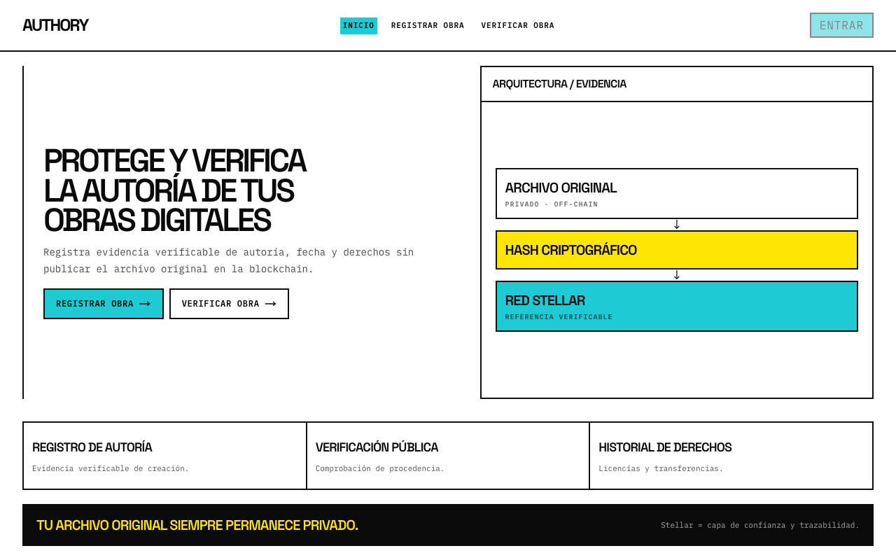
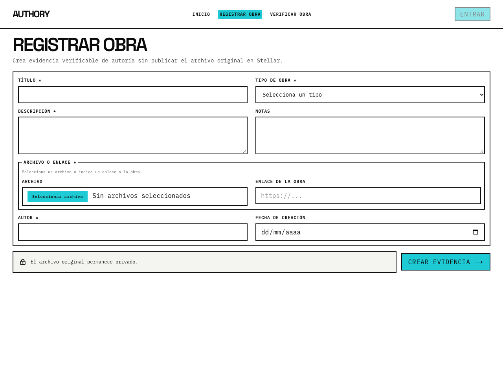
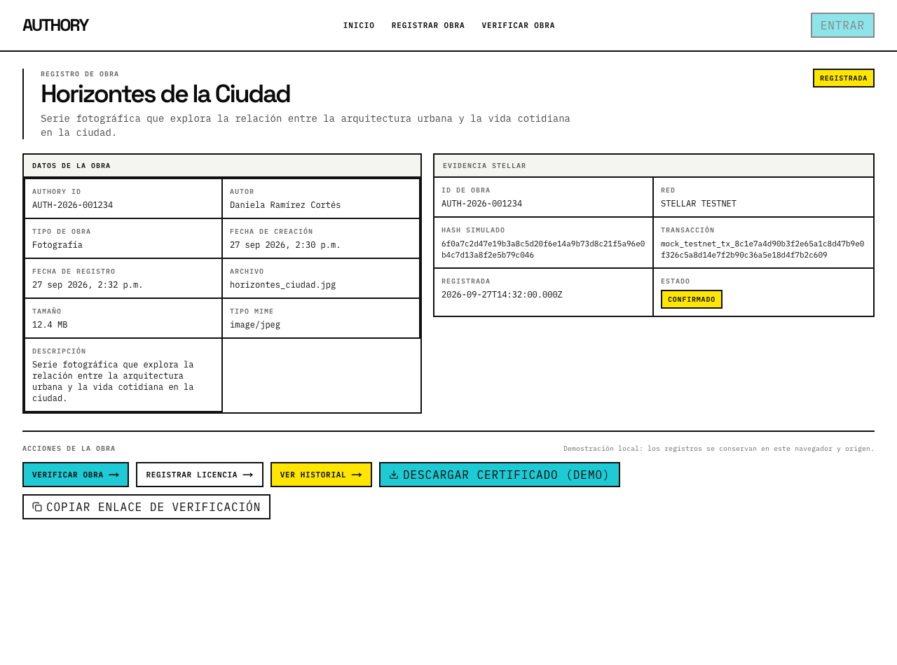
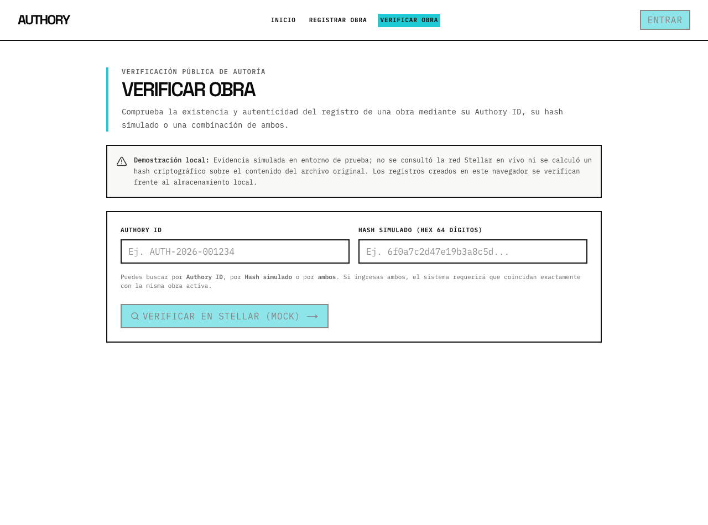
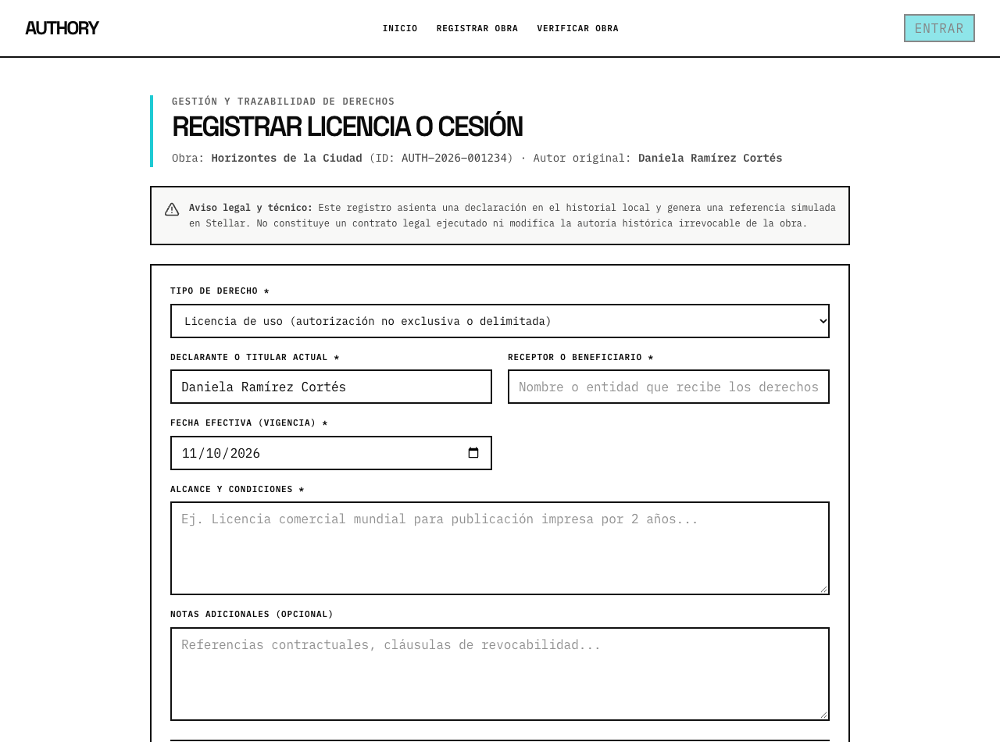
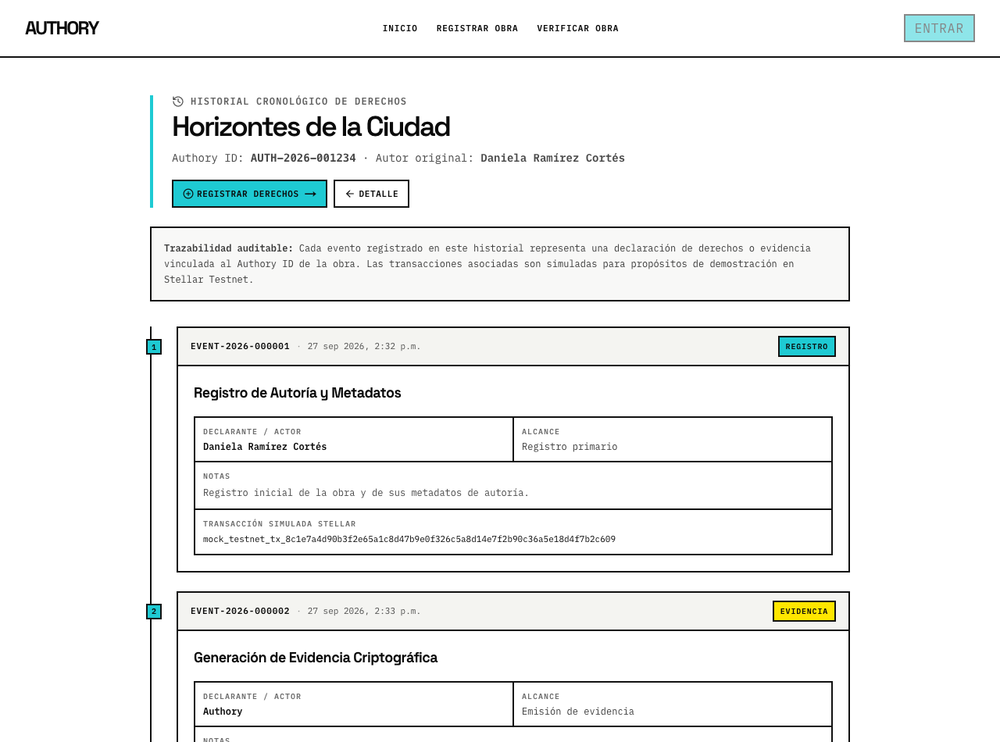

# Authory — Documentación de Entrega Semana 3 (Frontend 02)

**Fecha de entrega:** 10 de octubre de 2026  
**Rama de trabajo:** `feat/frontend-completion` (basada en `main` tras PR #8)  
**Stack tecnológico:** Next.js 16.4.0 (Turbopack, App Router), React 19.3.0, TypeScript 5, Tailwind CSS 4  

---

## 1. Front Construido

Se implementó y consolidó el flujo completo de seis pantallas funcionales acordadas para el Functional Proof de Authory, conforme a las especificaciones del Product Blueprint y el handoff operativo.

### Recorrido Principal de Usuario
```text
Inicio (/) 
  ↓
Registrar Obra (/registrar-obra) 
  ↓ [Generación de evidencia de 4 pasos]
Detalle de Obra (/obra/[id])
  ├── Verificación Pública (/verificar?workId=[id])
  ├── Registrar Derechos / Licencia (/obra/[id]/derechos)
  └── Historial de la Obra (/obra/[id]/historial)
```

### Detalle de Pantallas del Sistema

| # | Pantalla | Ruta | Propósito | Acciones Principales |
| :-: | :--- | :--- | :--- | :--- |
| **1** | **Inicio** | `/` | Presentación del valor de Authory, principios de privacidad y acceso directo a los flujos. | Botón "Registrar Obra →" y botón "Verificar Obra →". Muestra arquitectura conceptual y aviso de privacidad. |
| **2** | **Registro de Obra / Evidencia** | `/registrar-obra` | Captura de metadatos de la obra y simulación en 4 pasos del registro de evidencia en Stellar Testnet. | Formulario con validación (título, tipo, autor, fecha, notas, archivo o enlace). Botón "Crear evidencia →", animación por pasos de emisión y redirección al Detalle. |
| **3** | **Detalle de Obra** | `/obra/[id]` | Ficha técnica con metadatos del registro, tarjeta de evidencia en Stellar y utilidades de demostración. | Acciones directas: "Verificar Obra →", "Registrar Licencia →", "Ver Historial →", "Descargar Certificado (Demo)" y "Copiar Enlace de Verificación". |
| **4** | **Verificación Pública** | `/verificar` | Auditoría de procedencia e integridad mediante Authory ID, hash simulado o búsqueda combinada. | Entrada manual de ID o hash, lectura automática de query param `?workId=...`, botón "Verificar en Stellar (Mock) →", limpieza inmediata y anulación de búsquedas obsoletas. |
| **5** | **Derechos / Licencia** | `/obra/[id]/derechos` | Registro estructurado de eventos sobre derechos derivados (licencias de uso o cesiones patrimoniales). | Formulario reactivo validado con Zod (tipo, declarante/titular, beneficiario/receptor, alcance/términos, fecha de vigencia y notas). Botón "Registrar Evento de Derechos →". |
| **6** | **Historial Cronológico** | `/obra/[id]/historial` | Trazabilidad temporal completa de la obra desde su creación y evidencia inicial hasta licencias o cesiones. | Línea de tiempo ordenada por fecha de registro, badge por tipo de evento, detalle de términos, notas, referencias de transacción y botón de reintento ante fallos de reconciliación. |

### Certificado HTML de Demostración y Enlace Verificable
En la pantalla de **Detalle de Obra** (`/obra/[id]`):
- **Descargar Certificado (Demo):** Genera y descarga en el navegador un archivo HTML autónomo e imprimible (`certificado-demo-[id].html`). Cuenta con sanitización estricta contra inyección XSS de todos los campos ingresados y neutralización de URLs que no pertenezcan al protocolo HTTP/HTTPS. Muestra claramente la advertencia de que es un certificado de demostración funcional local.
- **Copiar Enlace de Verificación:** Copia en el portapapeles la URL absoluta que apunta a `/verificar?workId=[id]`, con confirmación interactiva en UI y campo de texto alternativo directamente seleccionable si el navegador bloquea la API de portapapeles.

### Estado de Construcción: Implementado vs. Probado vs. Pendiente

| Pantalla / Componente | Implementado | Probado | Pendiente |
| :--- | :---: | :---: | :--- |
| **1. Inicio (`/`)** | Sí | Sí (Unit/Lint/Browser) | Ninguno para el alcance de Semana 3. |
| **2. Registro de Obra (`/registrar-obra`)** | Sí | Sí (Focal tests + Browser) | Hashing criptográfico real sobre bytes y persistencia en backend compartido. |
| **3. Detalle de Obra (`/obra/[id]`)** | Sí | Sí (Focal tests + Browser) | Soporte para exportación en formato PDF firmado. |
| **4. Verificación (`/verificar`)** | Sí | Sí (Focal tests + Browser) | Verificación por subida de archivo para contrastar bytes reales contra blockchain. |
| **5. Derechos (`/obra/[id]/derechos`)** | Sí | Sí (Focal tests + Browser) | Ejecución mediante contratos inteligentes reales de Soroban. |
| **6. Historial (`/obra/[id]/historial`)** | Sí | Sí (Focal tests + Browser) | Paginación o virtualización para históricos masivos (futuro). |
| **Certificado HTML y Copiar Enlace** | Sí | Sí (Focal tests + Browser) | Acceso al enlace desde navegadores externos (requiere backend común). |

*Nota sobre pruebas:* Se validó la compilación de producción (`npm run build`), análisis estático (`lint`, `tsc`), una suite de 9 pruebas unitarias/focales (`npm test`) y pruebas manuales del flujo integral en navegador bajo servidor local de producción. No se declara "QA 100%" ni certificación de matriz multiplataforma exhaustiva (dispositivos físicos/móviles reales).

---

## 2. Evidencia Visual del Frontend

> **Estado del despliegue externo:** Actualmente **no existe una URL desplegada en hosting público** (como Vercel, Netlify o Cloudflare Pages). El despliegue externo se mantiene como un pendiente acordado del equipo para evitar costos o publicaciones no coordinadas. **No se presenta localhost como un deployment**.

Para verificar visualmente la interfaz construida, se levantó el frontend en modo de producción local (`npm start` en el puerto 3000) y se capturaron pantallas reales de las seis superficies implementadas:

### 1. Pantalla de Inicio (`/`)

*Vista principal de Authory que expone la propuesta de valor, el principio de privacidad del archivo off-chain y accesos a registro y verificación.*

### 2. Formulario de Registro de Obra (`/registrar-obra`)

*Formulario de captura de metadatos de autoría y selección de archivo/URL con advertencia clara de que el archivo original no se publica ni se sube a la red.*

### 3. Detalle de Obra y Evidencia (`/obra/[id]`)

*Ficha técnica con metadatos de autoría, tarjeta de evidencia simulada en Stellar Testnet, botones de navegación, descarga de certificado demo y copia de enlace.*

### 4. Verificación Pública de Obra (`/verificar`)

*Módulo de verificación pública con soporte de búsqueda por Authory ID y/o hash simulado de 64 dígitos hexadecimales con copy explícito de entorno de demostración.*

### 5. Registro de Licencias y Cesiones (`/obra/[id]/derechos`)

*Formulario estructurado para registrar cesiones o licencias no exclusivas vinculadas al Authory ID de la obra, sin modificar el autor original.*

### 6. Historial Cronológico de Derechos (`/obra/[id]/historial`)

*Línea de tiempo auditable que presenta en orden cronológico el registro inicial, la evidencia criptográfica simulada y los eventos de derechos posteriores.*

---

## 3. Decisión Técnica

### Estrategia de Implementación
Para la entrega de Semana 3 se implementó una aplicación web orientada a una **prueba funcional (Functional Proof)** utilizando el siguiente stack:
- **Framework & Runtime:** Next.js 16.4.0 (App Router, Turbopack) con React 19.3.0 y TypeScript 5.
- **Estilos:** Tailwind CSS 4 con un sistema de diseño técnico/brutalista consistente (fondos limpios, bordes marcados, acentos en cyan y amarillo, tipografías Space Grotesk e IBM Plex Mono).
- **Formularios y Validación:** React Hook Form integrado con Zod para validación exhaustiva de esquemas.
- **Persistencia Local:** Almacenamiento en `localStorage` mediante un módulo centralizado (`frontend/lib/storage.ts`).
- **Capa Blockchain:** Módulo de simulación de Stellar Testnet (`frontend/lib/stellar/mock-stellar.ts`).

### Justificación y Relación con el Product Blueprint
Esta arquitectura se adoptó de forma deliberada para permitir probar el flujo de usuario de punta a punta (las 6 pantallas) y validar las interacciones clave de UX sin incurrir en costos de infraestructura, latencias de red externa ni complejidad de gestión de billeteras durante esta etapa temprana.

En el Product Blueprint, la arquitectura de producción se define en tres capas:
1. **Archivo original:** Privado y fuera de la cadena (off-chain).
2. **Lógica y metadatos:** Backend tradicional, base de datos y almacenamiento privado.
3. **Capa de confianza:** Red Stellar para hashes y Soroban Smart Contracts para eventos de derechos.

La implementación actual respeta estrictamente estas fronteras:
- **El archivo original nunca se almacena ni se transmite:** No se guardan binarios, blobs ni Base64 en `localStorage`. Únicamente se conservan metadatos operativos (nombre, tamaño aproximado, tipo MIME).
- **Contratos de datos coherentes:** Los tipos de dominio (`Work`, `RightsEvent`, `StellarEvidence`, `VerificationInput`, `VerificationResult`) reflejan la estructura que posteriormente consumirá la API y los contratos inteligentes de Soroban.
- **Transición futura limpia:** Toda la persistencia y la simulación están centralizadas en `storage.ts` y `mock-stellar.ts`, lo que permitirá sustituirlas por llamadas a backend y RPC de Stellar sin tener que reescribir la interfaz.

### Precisiones sobre lo Simulado y Limitaciones Técnicas
Para garantizar total honestidad técnica en la entrega, se aclaran los siguientes puntos:
1. **Hash simulado:** El hash de 64 caracteres hexadecimales generado (`generateMockHash()`) es una cadena determinista o aleatoria de prueba; **no se calcula mediante el algoritmo SHA-256 sobre los bytes reales del archivo**.
2. **Sin transacciones blockchain reales:** Los identificadores de transacción (`mock_testnet_tx_...`) y las confirmaciones son simulaciones locales inmediatas; **no se envían operaciones a Horizon ni a Soroban RPC**.
3. **Persistencia en navegador único:** Los datos registrados residen en el `localStorage` del navegador local. Si un usuario copia el enlace de verificación y lo abre en otro navegador o dispositivo, la obra no existirá.
4. **Una sola obra activa:** El esquema de almacenamiento local conserva una obra activa en la clave `authory_work`. Registrar una nueva obra sustituye la anterior en la clave activa (aunque existe una obra demo predeterminada como respaldo).
5. **Persistencia observable sin atomicidad:** Se reconoce que `localStorage` no ofrece transacciones ACID entre múltiples claves (`authory_work` y `authory_events`). Por ello, `storage.ts` toma instantáneas previas y reporta explícitamente estados de guardado (`success`, `failed_restored`, `failed_partial_inconsistent`) en lugar de prometer atomicidad inexistente.

### Otras Decisiones Técnicas Acordadas
- **Certificado HTML en lugar de PDF:** Se acordó implementar un certificado HTML autónomo e imprimible en lugar de introducir librerías pesadas de generación de PDF en cliente (como jsPDF o pdfmake), evitando sobrecargar el bundle y problemas de dependencias en React 19.
- **Diseño sin etiquetas decorativas:** Conforme al handoff de Frontend 01, se eliminaron los rótulos numéricos decorativos ("01 / HOME", etc.) en favor de encabezados semánticos accesibles.

---

## 4. Participación de Cada Integrante

Las contribuciones se documentan a partir de la evidencia verificable registrada en el repositorio (documentos en `docs/semana1/`, `docs/semana2/`, commits en `main` y PRs):

| Integrante | Usuario de GitHub | Contribución Concreta Verificada | Fuente de Evidencia |
| :--- | :--- | :--- | :--- |
| **Daniela Ramírez** | `nidaela` | **Semana 1:** Coordinación del repositorio y consolidación del Problem Brief.<br>**Semana 2:** Propuesta de historias de usuario, redacción de propuesta de valor y flujo de usuario en Product Blueprint.<br>**Semana 3:** Implementación de Frontend 01 foundation (Next.js scaffold, dependencias, tipos de dominio, mock Stellar inicial, sistema visual brutalista, pantallas Home, Registro de Obra y Detalle de Obra; PR #8 mergeado a `main`). | Commits `ff1b312`, `7635836`, `8193d70`, `2753503`, `e448c48`, `0ab3a60`, `9bda59c`, `e390ae6`, `56f453f`, `817a505`, `be7f28e`, PR #8 (`5b2e8f6`). |
| **Alain Einstein Hussein Bonilla Cordero** | `aeh-bonilla` | **Semana 1:** Propuesta individual de problema en Problem Brief.<br>**Semana 2:** Historias de usuario, diseño del diagrama de arquitectura inicial con integración Stellar y redacción de secciones de arquitectura y uso de Stellar en Product Blueprint.<br>**Semana 3:** Elaboración del Plan de Implementación de Frontend 02 (`Authory_Frontend02_Implementation_Plan_Antigravity.md`), handoff operativo, implementación de Frontend 02 en rama de trabajo local `feat/frontend-completion` (persistencia con validación de contrato, 3 rutas nuevas `/verificar`, `/derechos`, `/historial`, certificado demo HTML, copy honesto, suite de pruebas `focal-cases.test.mjs`, QA en navegador, captura de screenshots y consolidación de documentación). *Nota: cambios locales pendientes de commit/PR*. | Commits `0cba060`, `8154ed3`, `4a2f9d4`, `ce81280`; documentos de planificación de Frontend 02 y archivos de trabajo en rama `feat/frontend-completion`. |
| **Rodrigo Ramírez** | `Rodrigo-IRS` | **Semana 1:** Propuesta individual de problema en Problem Brief.<br>**Semana 2:** Elaboración de historias de usuario individuales (incluyendo las 3 historias centrales del MVP: registro, verificación y constancia de cesión/licencia) y revisión de criterios de priorización en Product Blueprint.<br>**Semana 3:** *Por confirmar* (sin commits ni PRs registrados en el repositorio para Frontend 02). | Commits `4e83177`, `ccf063b`, `6bdb36f`, `c94ec9c`. |
| **Milvia Selene Escalona Ángeles** | `mescalona16-creator` / `Angeles-23` | **Semana 1:** Autora de la propuesta ganadora seleccionada para el proyecto en el Problem Brief.<br>**Semana 2:** Propuesta de historias de usuario (verificación de notario/auditor), elaboración e integración del Lean Canvas en Figma/GitHub para Product Blueprint.<br>**Semana 3:** *Por confirmar* (sin commits ni PRs registrados en el repositorio para Frontend 02). | Commits `dc3fbcb`, `1384afb`, `aed333a`, `39d779c`. |
| **Owen Isaac Bailón Cruz** | `OwenIBC` | **Semana 1:** Propuesta individual de problema.<br>**Semana 2:** Elaboración de historias de usuario individuales y revisión de la definición y justificación de alcance del MVP en Product Blueprint.<br>**Semana 3:** *Por confirmar* (sin commits ni PRs registrados en el repositorio para Frontend 02). | Commits `2db5275`, `7b9c835`, `91351e9`, `e7eb75b`. |

### Datos Faltantes por Confirmar para Completar esta Sección:
1. Confirmación de las actividades, revisiones o contribuciones específicas de Semana 3 realizadas por Rodrigo Ramírez, Milvia Selene Escalona y Owen Isaac Bailón.
2. Confirmación de si los integrantes cuentan con documentos individuales de Semana 3 en sus ramas locales para agregarlos al directorio `docs/semana3/`.

---

## 5. Bloqueos y Siguientes Pasos

### A. Bloqueos de la Entrega Actual (Semana 3)
1. **Decisión de hosting para despliegue público:** El equipo debe acordar la plataforma (Vercel, Netlify, Cloudflare Pages u otra), configurar el repositorio para despliegues continuos y autorizar el despliegue de la versión estable.
2. **Revisión y Merge de PR:** Los cambios de Frontend 02 en la rama `feat/frontend-completion` requieren revisión de código por parte de la coordinadora del repositorio (`nidaela`) antes de integrarse a `main`.
3. **Consolidación de aportes individuales de Semana 3:** Falta que los integrantes pendientes confirmen y aporten sus notas o documentos individuales de la semana.

### B. Limitaciones Deliberadas de la Demostración (Por Diseño)
Estas limitaciones fueron establecidas intencionalmente para acotar el alcance de la prueba funcional de Semana 3 y **no constituyen defectos ni bloqueos**:
- **Aislamiento en `localStorage`:** Los datos registrados no se sincronizan entre distintos navegadores ni computadoras.
- **Simulación criptográfica y de red:** No hay gasto de lumens de testnet ni interacción real con Horizon/Soroban; los hashes y transacciones son demostrativos.
- **Catálogo único:** La persistencia local mantiene una sola obra activa en el almacenamiento a la vez.

### C. Trabajo Futuro (Próximas Semanas)
*Estas funciones corresponden a la evolución del producto hacia el MVP completo y no son requisitos de la entrega de Semana 3:*

| Tarea Futura | Descripción Concreta | Responsable Confirmado |
| :--- | :--- | :--- |
| **Cálculo de Hash Real (SHA-256)** | Implementar el cálculo del hash criptográfico real sobre los bytes del archivo original en el navegador mediante Web Crypto API (`crypto.subtle.digest`). | Por definir por el equipo |
| **Backend & Almacenamiento Privado** | Desarrollar API para persistencia de metadatos de múltiples obras y almacenamiento privado seguro de archivos originales (off-chain). | Por definir por el equipo |
| **Autenticación y Billeteras Web3** | Integrar conexión con billeteras de Stellar (ej. Freighter) para autenticar la identidad del creador y firmar transacciones. | Por definir por el equipo |
| **Integración Real con Soroban en Testnet** | Desarrollar y desplegar smart contracts en Soroban para el registro de autoría y la trazabilidad de cesiones y licencias de derechos. | Por definir por el equipo |
| **Certificados Criptográficos en PDF** | Implementar generación de certificados en PDF con firma digital y verificación mediante código QR. | Por definir por el equipo |

---

## 6. Instrucciones de Ejecución y Validación Local

Para reproducir el entorno y ejecutar las pruebas de validación de esta entrega:

### Requisitos Previos
- Node.js 22+ (fijado en `.nvmrc`: `22.23.3`)
- npm

### Pasos de Ejecución
```bash
# Navegar al directorio del frontend
cd frontend

# 1. Ejecutar las 9 suites de pruebas unitarias y focales
npm test

# 2. Análisis estático (linter)
npm run lint

# 3. Comprobación de tipos en TypeScript
npx --no-install tsc --noEmit

# 4. Compilación para producción (Turbopack)
npm run build

# 5. Iniciar servidor local de producción
npm start
# La aplicación estará disponible en http://localhost:3000
```
